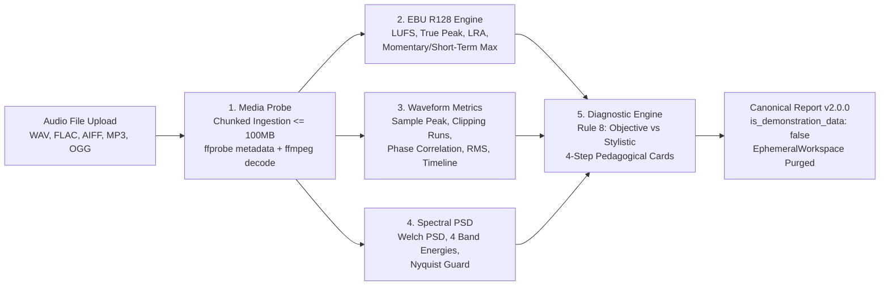

# MixLearn Studio — System Architecture Specification (Phase 2 DSP Engine)

## 1. Architectural Philosophy & Mission

MixLearn Studio is built on a fundamental educational motto:
> **"Learn mixing and mastering by doing mixing and mastering, and receive meaningful insights through AI."**

The platform is designed to demystify audio engineering for independent producers and musicians by coupling deterministic, mathematically verifiable digital signal processing (DSP) with contextual educational coaching.

```mermaid
flowchart TD
    subgraph Browser Client [Browser Client: React 19 + TypeScript + Tailwind CSS]
        CG[Five-Tier Consent Gate<br/>Analysis=ON, AI Metrics=OFF, Audio Inspect=OFF, Raw Audio=OFF, Training=OFF]
        SM[/simple: Simple Mix Check<br/>4-Step Beginner Action Plan]
        AM[/advanced: Advanced Mix Check<br/>14 DSP Metrics + Waveform Timeline]
        WI[Waveform Inspector<br/>Real DSP Timeline Buckets: 240 Buckets<br/>Synthetic Demo Fallback Disclosed]
        APIS[apiService.ts<br/>Relative API URLs + Vite Proxy]
    end

    subgraph Backend API [FastAPI Backend: Python 3.12+]
        H[Health & Capabilities<br/>/api/v1/capabilities<br/>Phase 2: dsp_core_measurements IMPLEMENTED]
        CR[Canonical Contract Schema v2.0.0<br/>contracts/analysis_report.schema.json]
        DSP[Phase 2 Mathematical DSP Engine<br/>POST /api/v1/analyze/dsp<br/>is_demonstration_data=false]
        DF[Phase 1 Demo Engine Fallback<br/>POST /api/v1/analyze/demo<br/>is_demonstration_data=true]
        ST[Phase 4 Genuine Stems<br/>Rule 1 Guard: 422 if AI]
        AI[Phase 5 Consent-Gated AI<br/>Gemini API Coaching<br/>Rule 4 Guard: 403 if Unconsented]
        EW[(Ephemeral Temp Workspace<br/>Auto-purged in finally block)]
    end

    Browser Client -->|POST /api/v1/analyze/dsp Audio Bounce| Backend API
    Backend API -->|Canonical AudioMixAnalysisReport v2.0.0 JSON| Browser Client
    Browser Client -.->|Fallback if Backend Unreachable| OFFLINE[(Offline Local Fixture Generator)]
```

---

## 2. Frontend / Backend Communication & API Routing Architecture

### Development Environment (Vite Proxy)
In local development, the browser client makes requests to relative paths (e.g., `/api/v1/health`, `/api/v1/analyze/dsp`, `/api/v1/analyze/demo`).
The Vite development server (port 3000) automatically proxies these requests to the local FastAPI backend (port 8000) via `vite.config.ts`:
```ts
server: {
  port: 3000,
  proxy: {
    '/api': {
      target: 'http://127.0.0.1:8000',
      changeOrigin: true,
    },
    '/health': {
      target: 'http://127.0.0.1:8000',
      changeOrigin: true,
    },
  },
}
```
This guarantees zero hardcoded `127.0.0.1` addresses in browser client code and prevents CORS conflicts.

### Production Routing Configuration
In production environments, API routing is handled via either of two supported configurations:
1. **Unified Origin Reverse Proxy (Recommended):** An ingress controller or reverse proxy (Nginx, Caddy, Cloud Run Service, or AWS CloudFront/ALB) routes `/api/*` and `/health` to the FastAPI container and `/` to static Vite assets. All frontend calls use relative URLs without additional configuration.
2. **Dedicated API Domain (`VITE_API_BASE_URL`):** If frontend and backend are hosted on distinct hostnames (e.g., `https://app.mixlearn.studio` and `https://api.mixlearn.studio`), set `VITE_API_BASE_URL=https://api.mixlearn.studio` at build time. The helper `buildApiUrl()` in `src/services/apiService.ts` automatically prepends this base URL.

---

## 3. Real Mathematical DSP Pipeline Architecture (`POST /api/v1/analyze/dsp`)

The Phase 2 signal processing engine replaces demonstration-only fixtures with authentic, deterministic mathematical analysis.



### Module Breakdown:
1. **Media Ingestion & Probe (`backend/app/dsp/media_probe.py`):**
   - **Streaming Ingestion:** Chunks file in 64 KB buffers, streams to disk in `EphemeralAudioWorkspace`, enforces a hard 100 MB (`104,857,600` bytes) cap (`HTTP 413 Payload Too Large`), and computes incremental SHA-256 hash.
   - **Format & Metadata Probe:** Invokes `ffprobe` (`timeout=10s`, `shell=False`) to extract duration, sample rate, channels, codec, bit rate, and format.
   - **Codec & Channel Validation:** Validates codec against WAV, FLAC, AIFF, MP3, and OGG Vorbis. Restricts channels to 1 (mono) or 2 (stereo); returns `HTTP 422 Unprocessable Content` if channels > 2. Restricts duration to $0 < \text{duration} \le 600$ seconds.
   - **Canonical Decoding:** Invokes `ffmpeg` to decode into raw 32-bit float PCM (`pcm_f32le`) at native sample rate.

2. **Loudness Analysis (`backend/app/dsp/loudness.py`):**
   - Computes Integrated Loudness (LUFS), Loudness Range (LRA in LU), 4x oversampled True Peak (dBTP), Short-Term Max (3s), Momentary Max (400ms), and per-frame time-series via FFmpeg `ebur128=peak=true:framelog=verbose`.
   - Dual-engine cross-validation via `pyloudnorm.Meter`.
   - Edge case handling: If audio duration is $<0.4$s or $<3.0$s, EBU R128 metrics return `value: null` with `status: "unavailable"` and `unavailable_reason: "file_duration_too_short_for_ebur128"`.

3. **Waveform & Dynamic Metrics (`backend/app/dsp/waveform_metrics.py`):**
   - Stream-reads decoded PCM in blocks of 65,536 frames via `soundfile.blocks()`, bounding memory footprint.
   - Computes absolute Sample Peak Max (dBFS).
   - Identifies contiguous sample clipping runs ($\ge 3$ consecutive samples $\ge 0.9999$).
   - Calculates Global RMS (dBFS) and Crest Factor (dB).
   - Computes silence-gated Stereo Phase Correlation across 400ms windows gated at $-60$ dBFS. For mono files, returns `value: null` with `unavailable_reason: "mono_input_no_stereo_field"`.
   - Calculates orthonormal Mid/Side stereo width index ($0..100\%$).
   - Downsamples audio envelope into $\le 240$ uniform timeline buckets with peak, RMS, and clipping flags.

4. **Spectral Analysis (`backend/app/dsp/spectral.py`):**
   - Computes per-channel Welch Power Spectral Density (`scipy.signal.welch`, Hann window, $n_{\text{perseg}}=8192$, 50% overlap).
   - Averages linear PSD across channels.
   - Integrates band energies: Sub-Bass (20–60 Hz), Low-Mid / Mud (200–500 Hz), Presence (2–5 kHz), High Air (10–20 kHz).
   - Nyquist Guard: If $f_s / 2 \le \text{band\_high}$, returns `value: null` with `unavailable_reason: "nyquist_limit_below_band_upper_bound"`.

5. **Diagnostic Engine (`backend/app/dsp/diagnostics.py`):**
   - Evaluates DSP measurements against genre- and mix-stage-specific reference targets.
   - Strictly enforces Rule 8: Objective technical issues (clipping runs, True Peak overs, phase cancellation) are categorized as `objective_technical`. Stylistic choices (spectral balance, loudness target) are categorized as `subjective_stylistic`.
   - Generates 4-step educational learning cards (*What was detected*, *Why it matters*, *What to try*, *How to verify*).

6. **Concurrency Guard:**
   - Protected by `asyncio.Semaphore(2)` in `main.py` to prevent memory exhaustion on low-RAM server instances.

---

## 4. Shared Engine, Dual-Interface Architecture

Both interfaces consume the exact same canonical `AudioMixAnalysisReport` contract (`contracts/analysis_report.schema.json` v2.0.0):

1. **Simple Mix Check (`/simple`) — For Beginners & Songwriters:**
   - **Inputs:** Genre, Production Stage (`unmastered_mix` or `final_master`), and uploaded stereo audio file.
   - **Presentation:** Suppresses intimidating spectral graphs and dense DSP jargon. Delivers a prioritized, plain-language action checklist and 4-step learning cards:
     1. *What was detected* (plain-English description of the sound and timestamp).
     2. *Why it matters* (impact on real-world speaker translation or streaming playback).
     3. *What to try* (concrete fader, EQ, limiter, or width adjustment in the user's DAW).
     4. *How to verify* (what to listen for and target status on re-export).
   - Displays `[MATHEMATICAL DSP ANALYSIS · REAL AUDIO MEASUREMENTS]` badge when real DSP analysis is returned.

2. **Advanced Mix Check (`/advanced`) — For Intermediate Engineers:**
   - **Inputs:** Genre, Production Stage, Primary Stereo Bounce, Optional Genuine Original Stems (Phase 4), Plugin-Chain Metadata, and 5-Tier Consent.
   - **Presentation:**
     - 15 Standardized Mathematical DSP Metrics across 5 domains (Loudness, Peaks, Dynamics, Frequency, Stereo).
     - Real DSP SVG peak/RMS waveform timeline ($\le 240$ buckets) with interactive timestamp region highlighting.
     - Handles unavailable metrics with clear `N/A` badges and technical reason tooltips.
     - Dual-column diagnostic split: `objective_technical` warnings vs. `subjective_stylistic` observations.
     - Genuine Original Stem Origin Validator (Rule 1 enforcement).
     - Reserved forward-compatible slots for Phase 3–5 capabilities with explicit user disclosures.

---

## 5. Strict Exclusion of AI Stem Separation (Rule 1)

MixLearn Studio strictly forbids AI stem separation, automatic demixing, or pseudo-stem generation.

### Why AI Stem Splitting Is Permanently Prohibited:
1. **Phase Cancellation Artifacts:** Neural stem separation models introduce time-frequency smearing, phase non-linearities, and spectral filtering artifacts.
2. **False Measurement Data:** Running mathematical phase correlation or dynamic masking analysis on AI-separated stems measures algorithmic artifacts rather than the producer's actual mix balance.
3. **Engineering Integrity:** Educational feedback must be based on genuine audio stems exported directly from the user's DAW.

Any stem upload with `stem_source_type != "user_uploaded_original"` is rejected at the API boundary with `HTTP 422 Unprocessable Content`.

---

## 6. Ephemeral Infrastructure & Privacy Boundary (Rule 9)

MixLearn Studio embraces lean, zero-unnecessary-infrastructure engineering:
- **No Database:** Reports are stateless and generated dynamically on request.
- **No Authentication Wall:** No accounts or email sign-ups required to learn.
- **No Persistent Cloud Audio Storage:** Uploaded files exist solely in an ephemeral local temporary directory during DSP processing.
- **Auto-Purge Guarantee:** Temporary processing directories are wrapped in `EphemeralAudioWorkspace` with automatic recursive deletion in `finally` blocks.
- **Zero External Transmission:** No audio or metrics are transmitted outside the host during DSP analysis.
