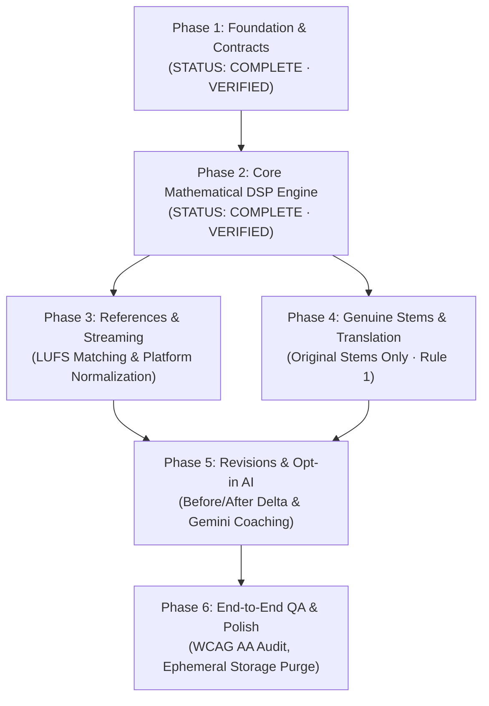

# MixLearn Studio — Six-Phase Architectural Roadmap & Phase Gates

## 1. Overview of the Six-Phase Architecture

MixLearn Studio is constructed according to a strict multi-phase delivery model where each phase delivers self-contained, verifiable software while locking architectural boundaries for subsequent phases:

---

## 2. Phase 1 Definition of Done (Verified Complete)

- [x] **Canonical Shared JSON Schema:** `contracts/analysis_report.schema.json` pinned to `1.0.0` with pure validators.
- [x] **Demonstration Data Transparency:** `is_demonstration_data: true` enforced on all mock data with prominent user banners.
- [x] **Granular 5-Tier Consent Gate:** `audio_analysis_consent`, `external_ai_transfer_consent`, `ai_numerical_metrics_transfer_consent`, `ai_audio_content_inspection_consent`, `raw_audio_transfer_consent`, `model_training_opt_in` (strictly false by default per Rule 5).
- [x] **Dual-Interface Frontend Routes:** Simple Mix Check (`/simple`), Advanced Mix Check (`/advanced`), Architecture Handoff (`/architecture`).
- [x] **FastAPI Backend Boundaries:** Implemented `/health`, `/api/v1/health`, `/api/v1/capabilities`, `/api/v1/demo/report`, and `POST /api/v1/analyze/demo`.
- [x] **Automated Test Infrastructure:** Node unit tests and Python test suites verifying contract boundaries.

---

## 3. Phase 2 Definition of Done (Verified Complete)

Phase 2 replaces synthetic demonstration measurements with an authentic, deterministic mathematical DSP analysis pipeline:

- [x] **Real Mathematical DSP Engine (`POST /api/v1/analyze/dsp`):**
  - Chunked streaming upload with hard 100 MB cap (`104,857,600` bytes) and incremental SHA-256 computation.
  - Multi-format ingestion: WAV (PCM 16/24/32-bit int & 32-bit float), FLAC, AIFF, MP3, and OGG Vorbis decoded via `ffmpeg` to standard 32-bit float PCM.
  - EBU R128 Loudness engine extracting Integrated LUFS, Loudness Range (LRA), True Peak (4x oversampled), Momentary Max, Short-Term Max, and per-frame time-series.
  - Block-streaming waveform metrics (`soundfile.blocks` 65536 frames): Sample Peak Max, $\ge 3$ consecutive sample clipping runs, RMS, Crest Factor, silence-gated stereo phase correlation (400ms windows, $-60$ dBFS gate), and Mid/Side stereo width index ($0..100\%$).
  - Spectral analysis: Per-channel Welch PSD (`scipy.signal.welch`, Hann, $n_{\text{perseg}}=8192$, 50% overlap), linear channel averaging, and 4-band integration (Sub-Bass, Low-Mid, Presence, High Air) with Nyquist safety checks.
  - Rule 8 diagnostic engine separating objective defects from subjective stylistic notes, producing 4-step actionable learning cards.
- [x] **Canonical Schema Migration (1.0.0 → 2.0.0):**
  - Nullable `measurementValue.value`, status enum with `"unavailable"`, `unavailable_reason`, `algorithm_detail`, `file_metadata.codec`, `bit_depth_note`, broadened `sample_rate_hz` (`8000..384000`), `measurements.sample_peak_max`, and top-level `timeline` ($\le 240$ buckets).
  - TypeScript types and pure validator updated and passing.
- [x] **18 Test Fixtures & Numerical Tolerances Verified:**
  - Complete verification across all 18 fixtures covering 1 kHz sine waves at exact amplitudes, multi-format decodes, high loudness masters, clipping runs, Nyquist edge cases, short audio files, and mono inputs.
  - All numerical tolerances within exact bounds ($\pm 0.1$ LUFS, $\pm 0.1$ dBTP, $\pm 0.05$ phase correlation).
- [x] **Dual-Interface Consumption Verified:**
  - Simple Mix Check and Advanced Mix Check consume identical real DSP reports.
  - WaveformInspector renders real mathematical DSP timeline buckets with `[MATHEMATICAL DSP TIMELINE (REAL AUDIO ENVELOPE)]` badge.
- [x] **Security & Privacy Boundary:**
  - Files processed inside `EphemeralAudioWorkspace` with guaranteed recursive cleanup in `finally` blocks (zero disk residue).
  - `asyncio.Semaphore(2)` concurrency guard preventing OOM.
  - Absolute zero external network calls or LLM inference during DSP analysis.
- [x] **Automated Verification:**
  - 37 Pytest tests passing (`pytest backend/tests/`).
  - 15 Vitest tests passing (`npm test`).
  - 26 Edge CDP browser acceptance tests passing (`npm run test:browser`).
  - 0 ESLint errors (`npm run lint`).
  - Production build clean (`npm run build`).

---

## 4. Strict Gate to Phase 3: Pre-Conditions

> [!IMPORTANT]
> **PHASE 2 STATUS: COMPLETE & FULLY VERIFIED**
> **NEXT_PHASE_ALLOWED_TO_START (Phase 3): FALSE**
> Do not begin Phase 3 implementation until Phase 2 is formally approved by the user.

### Phase 3 Scope (Pending Approval):
- Streaming loudness normalization prediction (Spotify, Apple Music, YouTube, Tidal).
- Reference track curve comparison (spectrum matching and target crest factor delta).
- Endpoints remain strictly guarded (`POST /api/v1/simulate/streaming` $\to$ `HTTP 501`, `POST /api/v1/compare/reference` $\to$ `HTTP 501`).
