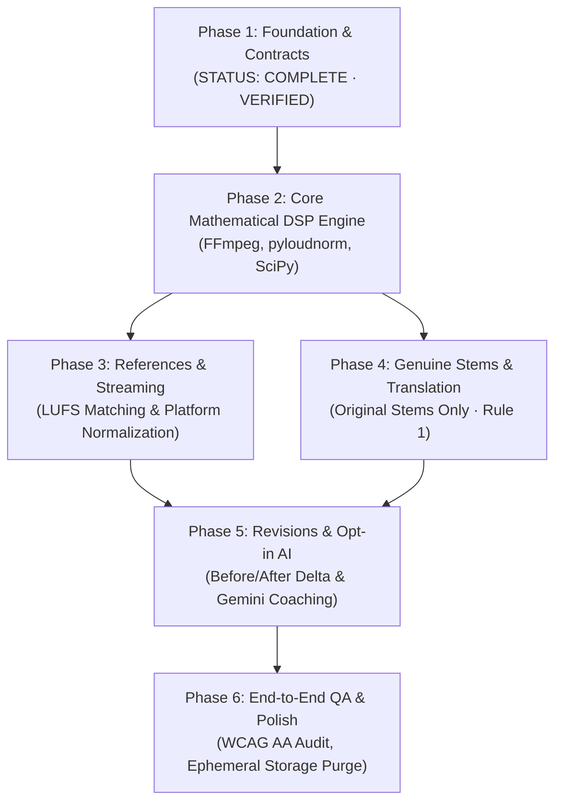

# MixLearn Studio — Six-Phase Architectural Roadmap & Phase Gates

## 1. Overview of the Six-Phase Architecture

MixLearn Studio is constructed according to a strict multi-phase delivery model where each phase delivers self-contained, verifiable software while locking architectural boundaries for subsequent phases:

---

## 2. Phase 1 Definition of Done (Verified Complete)

Phase 1 establishes the bedrock on which all future phases build:

- [x] **Canonical Shared JSON Schema:** `contracts/analysis_report.schema.json` pinned to `1.0.0` with pure validators.
- [x] **Demonstration Data Transparency:** `is_demonstration_data: true` enforced on all mock data with prominent user banners.
- [x] **Granular 3-Tier Consent Gate:** `audio_analysis_consent` (default true), `external_ai_transfer_consent` (default false), `model_training_opt_in` (default false per Rule 5).
- [x] **Dual-Interface Frontend Routes:**
  - `/` (Home/Overview with 10 Product Rules summary)
  - `/simple` (Beginner 4-step action workflow)
  - `/advanced` (Intermediate 14 DSP metric workbench, waveform inspector, and stem validator)
  - `/architecture` (Interactive architecture handoff and live API endpoint probe)
- [x] **FastAPI Backend Boundaries:** Implements `/health`, `/api/v1/health`, `/api/v1/capabilities`, `/api/v1/contracts/schema`, `/api/v1/demo/report`, and `POST /api/v1/analyze/demo`; enforces `501 Not Implemented` for Phases 2–5 and `422 Unprocessable Content` for Rule 1 stem violations.
- [x] **Automated Test Infrastructure:**
  - TypeScript contract tests (`npx --yes tsx --test src/contracts/analysisContract.test.ts`): 6 passing tests.
  - Python pytest suite (`pytest backend/tests/test_phase1_contracts.py`): 13 passing tests.
  - Cross-platform schema verification (`node scripts/validate_schema.js`): 0 errors.
  - Frontend production build (`npm run build`): 0 errors.
- [x] **Ephemeral Workspace Utility:** `EphemeralAudioWorkspace` context manager verifying zero disk residue on completion.

---

## 3. Strict Gate to Phase 2: Pre-Conditions

> [!IMPORTANT]
> **NEXT_PHASE_ALLOWED_TO_START: FALSE**
> Do not begin Phase 2 implementation until Phase 1 is formally approved and accepted.

### Mandatory Phase 2 Prerequisites:
1. All Phase 1 tests pass locally and in GitHub Actions CI.
2. The user has reviewed and accepted the Phase 1 demonstration and architecture documents.
3. No code in Phase 1 executes or mocks fake DSP analysis.

---

## 4. Unresolved Engineering Risks for Phase 2–5 Handoff

1. **Large Uncompressed WAV Upload Latency (Phase 2):**
   - 24-bit / 96 kHz stereo WAV files can reach 100–200 MB in size.
   - *Mitigation strategy:* Phase 2 must process audio in streamed chunks via `soundfile.blocks()` rather than loading full multi-channel arrays into memory at once, and compute 4x oversampled True Peak with polyphase filters (`scipy.signal.resample_poly`).
2. **Browser Audio Decoding Limits (Phase 4):**
   - Mobile browsers frequently crash or exhaust memory if attempting to decode multiple full-length multitracks simultaneously via `AudioContext.decodeAudioData()`.
   - *Mitigation strategy:* All multitrack phase masking math must be calculated server-side in Python/SciPy, with the browser receiving lightweight visualization envelopes and streaming audio snippets.
3. **AI Hallucination Containment (Phase 5):**
   - Large language models may attempt to contradict or invent audio measurements.
   - *Mitigation strategy:* Strictly enforce Rule 2: AI prompts receive sanitized numerical dictionaries and can generate instructional prose only. The frontend renders measurements exclusively from the deterministic DSP measurement dictionary.
