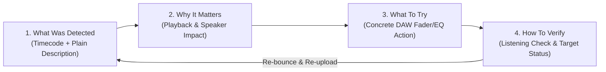

# MixLearn Studio — Product Specification & Educational Workflow

## 1. Executive Summary & Target Audience

MixLearn Studio is a privacy-first educational audio engineering web platform that bridges the gap between raw DSP meter readouts and concrete musical adjustments in the digital audio workstation (DAW).

### Target Personas:
1. **The Independent Songwriter / Bedroom Producer (Simple Mode):**
   - Understands musical arrangement and performance.
   - Intimidated by complex spectral analyzers, LUFS graphs, and mathematical jargon.
   - Needs plain-English action items and clear explanations of why their mix sounds muddy in the car or distorted on phones.
2. **The Intermediate Audio Engineer / Beatmaker (Advanced Mode):**
   - Familiar with parametric EQ, bus compression, and brickwall limiters.
   - Seeks objective, standards-compliant verification (ITU-R BS.1770-4, EBU R128).
   - Needs timestamped region auditioning, mono-sum phase cancellation detection, and multi-band spectral analysis.

---

## 2. The 4-Part Educational Learning Cycle

Every detected mix defect in MixLearn Studio is presented through a structured pedagogical framework:

1. **What was detected:** Transparent identification of the acoustic or technical event with exact start and end timestamps (e.g. `00:42.5–00:58.0 Chorus 1`).
2. **Why it matters:** Real-world consequence explained in acoustic terms (e.g., intersample peaks clipping consumer DACs, or low-mid buildup masking vocal clarity).
3. **What to try:** Specific, actionable DAW parameter adjustments (e.g., "Pull master limiter ceiling down to -1.0 dBTP" or "Apply dynamic bell cut of -2.5 dB at 280 Hz on the rhythm guitars").
4. **How to verify:** Self-contained auditory test and objective metric target to confirm on the next bounce.

---

## 3. Dual-Interface Feature Matrix

| Feature | Simple Mix Check (`/simple`) | Advanced Mix Check (`/advanced`) |
| :--- | :--- | :--- |
| **Primary Audience** | Beginners, Songwriters | Intermediate Engineers, Beatmakers |
| **Input Selection** | Genre, Mix Stage, Audio File | Genre, Mix Stage, Audio File, Stems, Plugins |
| **Metric Display** | Suppressed (Plain Action Cards) | 14 Standardized DSP Metrics with Units |
| **Waveform Display** | Hidden to prevent cognitive overload | Interactive Peak/RMS SVG with Clickable Regions |
| **Audio Audition** | Standard stereo playback | Stereo vs. Mono Sum (`L+R`) A/B Toggle |
| **Issue Categorization**| Visual Separation: Technical vs. Stylistic | Dual-Column Split: `objective_technical` vs. `subjective_stylistic` |
| **Action Checklist** | Ranked Prioritized DAW Checklist | In-depth engineering guidance & evidence data |
| **Forward Capabilities**| Hidden | Surfaced as explicit Phase 3–5 NOT_IMPLEMENTED cards |

---

## 4. Input Specifications & Supported Formats

- **Supported Containers:** WAV, FLAC, AIFF, MP3, OGG.
- **Recommended Upload:** 24-bit PCM WAV or FLAC (lossless uncompressed audio).
- **Supported Sample Rates:** 44.1 kHz, 48.0 kHz, 88.2 kHz, 96.0 kHz, 192.0 kHz.
- **Supported Bit Depths:** 16-bit, 24-bit, 32-bit float.
- **Channel Configuration:** 2 Channels (Stereo Interleaved).
- **Maximum File Size:** 150 MB (Configurable via `MAX_UPLOAD_MB`).

---

## 5. The 14 Standardized Mathematical DSP Measurements

| Metric Key | Metric Label | Unit | Measurement Standard | Target Range (Unmastered) | Target Range (Master) |
| :--- | :--- | :--- | :--- | :--- | :--- |
| `integrated_loudness` | Integrated Loudness | LUFS | ITU-R BS.1770-4 / EBU R128 | -18.0 to -14.0 LUFS | -14.0 to -8.5 LUFS |
| `short_term_max_loudness` | Short-Term Max (3s) | LUFS | EBU R128 (3-second window) | -16.0 to -11.0 LUFS | -11.0 to -6.5 LUFS |
| `momentary_max_loudness` | Momentary Max (400ms) | LUFS | EBU R128 (400ms window) | -14.0 to -9.0 LUFS | -9.0 to -5.0 LUFS |
| `true_peak_max` | True Peak Max | dBTP | ITU-R BS.1770-4 (4x Sinc) | <= -3.0 dBTP | <= -1.0 dBTP |
| `sample_clipping_events` | Sample Clipping Events | count | Full-Scale 0 dBFS Counter | 0 count | 0 count |
| `loudness_range_lra` | Loudness Range (LRA) | LU | EBU Tech 3342 | 5.0 to 12.0 LU | 4.0 to 9.0 LU |
| `crest_factor` | Dynamic Crest Factor | dB | Peak-to-RMS Envelope | 12.0 to 18.0 dB | 8.0 to 14.0 dB |
| `phase_correlation_mean` | Phase Correlation (Mean) | correlation | Pearson Correlation (-1 to +1)| +0.40 to +0.95 | +0.40 to +0.95 |
| `phase_correlation_min` | Phase Correlation (Min) | correlation | 400ms Window Worst Dip | >= +0.10 | >= +0.05 |
| `stereo_width_index` | Stereo Width Index | percent | Mid/Side Ratio `S/(M+S)` | 30% to 55% | 35% to 60% |
| `sub_bass_energy_20_60hz` | Sub-Bass Energy | dBFS | Welch PSD (20–60 Hz) | Context-dependent | Context-dependent |
| `mud_band_energy_200_500hz`| Low-Mid / Mud Band | dBFS | Welch PSD (200–500 Hz) | Context-dependent | Context-dependent |
| `presence_band_energy_2k_5khz`| Presence Band | dBFS | Welch PSD (2–5 kHz) | Context-dependent | Context-dependent |
| `air_band_energy_10k_20khz` | High Air Band | dBFS | Welch PSD (10–20 kHz) | Context-dependent | Context-dependent |

---

## 6. Rule 8 Separation: Technical Defects vs. Stylistic Notes

To ensure producers are never misled:
- **Objective Technical Defects (`objective_technical`):** Signal boundary violations that cause playback distortion regardless of genre (true-peak intersample overs, digital sample clipping, negative phase correlation causing mono cancellation).
- **Subjective Stylistic Notes (`subjective_stylistic`):** Genre and aesthetic considerations (tonal warmth, heavy bass, tight compression). Evaluated purely as creative artistic options that the producer is free to adopt or reject.
